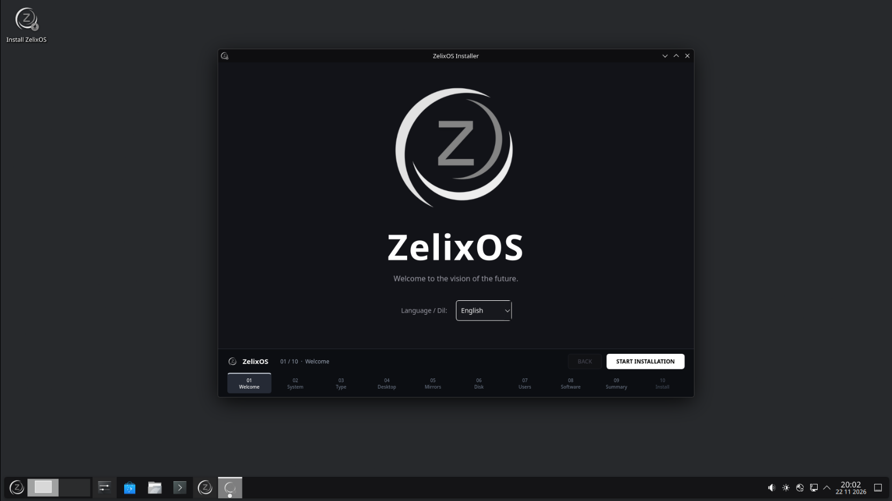
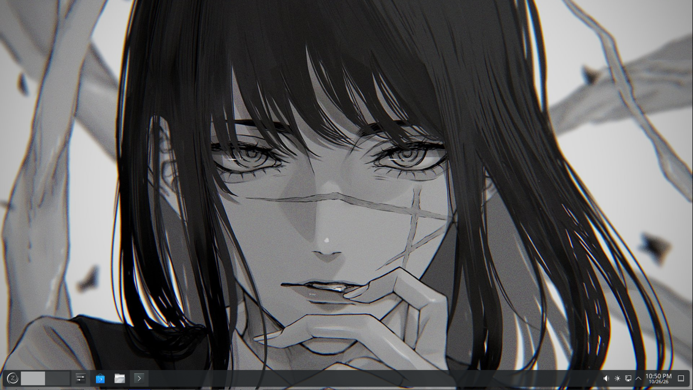
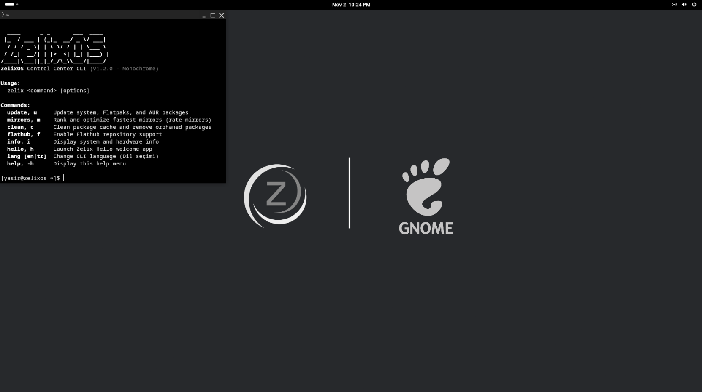

# Zelixins

Zelixins is the graphical installer for ZelixOS. It uses Archinstall for the base system installation, then applies the selected ZelixOS applications, desktop settings, and appearance components. The interface is written in Python and PyQt6.



The installer interface supports English, Turkish, and Spanish. The language selected here is independent of the locale installed on the target system.

## Before you install

- Boot the ZelixOS live ISO and connect to the internet. Installation packages are downloaded from configured Arch and Zelix repositories.
- Back up files from every disk you might select. The installer creates a new partition layout on the selected disk and erases its existing data.
- The target disk must have at least 25 GiB. The installer shows a proposed partition layout before installation.
- The installer does not currently offer manual partition editing or disk encryption. Do not continue if the generated layout does not suit your needs.
- When testing, use a virtual machine first. Check the firmware mode, selected bootloader, desktop session, and reboot behavior.

## Installation walkthrough

The installer has ten screens. Use **Back** and **Next** to move between setup screens; the summary screen is the last point to review choices before disk changes begin.

### 1. Welcome and installer language

Choose English, Türkçe, or Español in the language selector, then start the installation flow. This changes the installer interface only. You select the language for the installed system on the next screen.

### 2. System and regional settings

Set the installed system locale, keyboard layout, and time zone. Choose one or more kernels: Stable Linux, LTS, Zen, or Hardened. Select the bootloader that matches the machine's firmware. The available choices are systemd-boot and rEFInd for UEFI, and GRUB for BIOS or UEFI; on a BIOS boot, select GRUB.

### 3. Installation type and appearance

Choose a starting profile. **Minimal** installs the selected desktop and its essential packages; **Standard** adds Zelix Hello, Updater, CLI, Firefox, Dolphin, Konsole, Fastfetch, and compatible Aurora themes; **Full Experience** adds common multimedia, office, graphics, development, Flatpak, Paru, and wallpaper packages. **Custom** lets you choose individual applications and appearance components. Editing a preset switches it to Custom.

Appearance components can include the desktop theme, wallpaper collection, SDDM theme, Plymouth boot splash, and GRUB theme. Some options depend on the selected login manager or bootloader, so incompatible choices are disabled.

### 4. Desktop sessions and login manager

Select one or more sessions: KDE Plasma, GNOME, Xfce, Hyprland, Sway, i3, or bspwm. If you select multiple desktops, each appears as a session at the login screen. Choose a login manager supported by every selected desktop. The installer filters incompatible combinations and checks the choice before moving on.

Available desktop previews are in [`previews/`](previews/README.md): [KDE Plasma](previews/kde-plasma.png), [GNOME](previews/gnome.png), [Xfce](previews/xfce.png), [Hyprland](previews/hyprland.png), [Sway](previews/sway.png), [i3](previews/i3.png), and [bspwm](previews/bspwm.png).

| KDE Plasma | GNOME |
| --- | --- |
|  |  |

### 5. Package mirror regions

Select one or more regions near you to provide package download mirrors. The worldwide mirror is selected by default. A working network connection is required; slow or unreachable mirrors can make package installation take longer or fail.

### 6. Target disk and partition layout

Refresh the disk list if a drive is missing, then select the **whole target disk** carefully. Choose the root filesystem (Ext2/3/4, Btrfs, XFS, or F2FS). You may create a separate `/home` partition and choose its filesystem and the root partition size. Btrfs can use Zstandard compression; the preview updates as you change the layout.

The installer creates a boot partition (FAT32 on UEFI, Ext4 on BIOS), a root partition, and an optional separate home partition. Btrfs layouts use subvolumes. It does not create a swap partition. This is an automatic layout: manual partition editing, encryption, and preserving existing partitions are not currently available.

> **Destructive operation:** Proceeding formats the selected disk and removes its existing data. Confirm the device name and size in the partition preview. If you are unsure which disk is the target, stop and identify it in the live session before continuing.

### 7. Root password and user accounts

You can set and confirm a root password. Add at least one regular user; the installer requires a user for a desktop login. Confirm the user's password and choose whether that account receives administrator (`sudo`) privileges. Administrator access is enabled by default. User names must be lowercase and may contain numbers, `_`, or `-`.

### 8. Applications and optional packages

Review the packages selected by the installation profile, search the catalogue, and add or remove optional packages. Depending on the item, the source may be an Arch repository, ZelixRepo, Flatpak, or AUR. You can also enter a package name from an enabled Arch repository. Steam requires multilib, which the installer enables when needed. Essential packages for the selected desktop are retained.

### 9. Installation summary

Review the target disk and generated layout, locale, desktop sessions, login manager, keyboard, time zone, mirror regions, kernels, bootloader, users, and selected applications. Go back to change a choice. The **Start Installation** action asks you to confirm the destructive disk operation.

### 10. Installation progress and first boot

Keep the computer powered on and wait while the installer displays Archinstall and post-install output. Do not close the installer or power off while work is in progress. If an error appears, save the visible output for troubleshooting. After a success message, restart, remove the installation media when prompted, and sign in with the user account you created.

## Troubleshooting

| Symptom | What to check |
| --- | --- |
| No target disk appears | Refresh the list; check that the VM or firmware exposes a disk and that storage is not hidden behind an unsupported controller. |
| The disk layout is rejected | Check that the target is at least 25 GiB and that the selected filesystem and separate-home sizes fit. |
| Package downloads fail | Check live-session networking and the selected mirror regions, then retry with reachable mirrors. |
| No compatible login manager is available | Change the selected desktop sessions or choose a login manager supported by all of them. |
| The installed system does not boot | Check whether the machine booted in UEFI or BIOS mode and whether the selected bootloader matches it. Review the install log and test the same configuration in a VM. |
| A selected application is unavailable | Confirm that the required repository is enabled and the live session has internet access. Custom package names are checked against enabled Arch repositories. |

## Run from source

The installer is intended to run in the ZelixOS live session, where Archinstall, package tools, filesystem utilities, and the ZelixOS payload are available:

```bash
zelix-installer
```

For interface development, install Python, PyQt6, Qt translations and image formats, then launch it from the source directory:

```bash
python myself.py
```

The source-only launch does not provide a complete installation environment. Disk and install operations require the live-session tools and administrator privileges.

## Project layout

| Path | Purpose |
| --- | --- |
| `myself.py` | Main window, navigation, translations, and install flow |
| `desktop_page.py`, `installation_type_page.py` | Desktop/login-manager and profile selections |
| `disk_page.py`, `disk_layout.py` | Disk selection, generated partition plan, and validation |
| `installer_support.py`, `system_locale.py` | System helpers and installed locale configuration |
| `zelix_post_install.sh` | Post-install configuration |
| `zelixdeps/` | Optional desktop, login, boot, and wallpaper assets |
| `previews/`, `backgrounds/`, `icons/` | Installer preview and interface assets |

The package recipe and stable package index are maintained in [ZelixRepo](https://github.com/ZelixOS/zelix-repo/tree/main/zelixins).

## Contributing

Bug reports and changes should include the installer version, live ISO version, firmware mode, selected desktop/login manager, filesystem and disk size, the steps to reproduce, and relevant installation output. Remove passwords and personal data from logs. Test disk changes in a virtual machine before using physical hardware.
